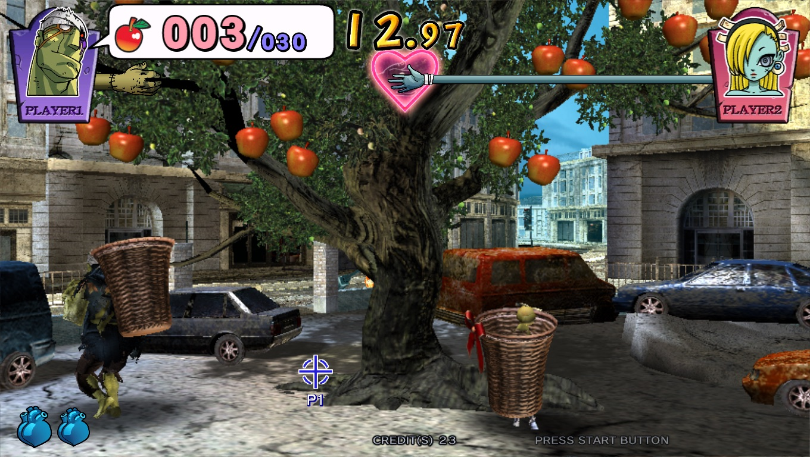
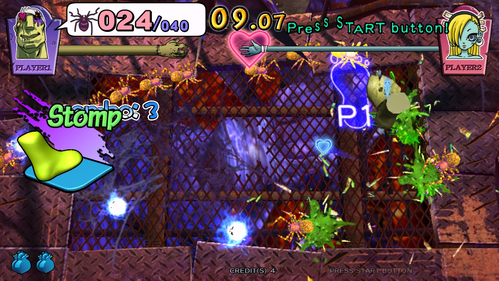

# The House of the Dead EX on macOS

Bring a readable game tree containing `elf/hodexRI.elf` and `fs/`:

```sh
./scripts/build-macos.sh hotdex /path/to/hotdex
./scripts/run-macos.sh hotdex /path/to/hotdex
```

This is an experimental macOS port using the same shared runtime as the
other games. It runs in the game's 1360x768 widescreen mode. Quest support
is deferred.

## Source identity

The development copy was read from `/roms/lindbergh/hotdex` in the user's
Batocera v43 image. Its `game.sh` launches `hodexRI.elf` from `elf/`.
The unstripped executable's SHA-256 is
`6977e02f75de33c51579aa43ebbda104b05dc993f83cc98cac745b8d023d0d14`.
The VGA executable and operator-test executables are separate binaries.

No game files or generated C belong in this repository. The local source
tree is kept separately; the NAS image is unchanged.

## Controls

The controls follow HOTD4: mouse aim, left button fire, right
button/off-screen reload, `5`/`1` coin/start (`6`/`2` for player two), `T`/`S`
test/service and `M` mute. The pedal uses the rebindable Action button
(`Space`). Change bindings, sound or language through the macOS menu bar.
The default sound setting is muted; `M` toggles it.

The pedal goes through JVS, so the game retains its own press, held and
release behavior. Both cabinet pedals are on the first JVS player's switch
byte: player one's pedal is bit 3, player two's is bit 2. The shared runtime
routes each player's Action input through the game profile. Desktop aiming
follows the existing ports and does not add a second physical mouse.

## Runtime support

The game and its supplied `librnalindbergh_jr.so` and
`libcri_soundoutput_lindbergh_jr.so` are lifted locally. Their CRI decoder and
mixing callbacks remain guest code; the shared runtime sends the resulting
48 kHz, six-channel PCM to SDL. Muting silences the output without stopping
the audio clock. `LINDBERGH_ALSA_METER=1` measures the source PCM before mute.

GLSL compatibility conversion, library export resolution, C++ container
operations and the required x86 instructions live in the shared toolkit and
lifter. The EX host contains only its profile and a gun-position hook at
`CInputJvs::GetPosition`, the path normal gameplay actually reads. Positions
follow the pointer directly in the cabinet's coordinate system.

## Validation

Development evidence is kept locally in `build-mac/hotdex-evidence/`:

These checks ran on an Apple M4 Pro with macOS 27.0.1.

- Clean startup, logo/title sequences, English menus, coin/start and minigame
  selection have run on Apple Silicon.
- Pedal minigames `pedalgame03` and `pedalgame01` ran through gameplay and
  returned to selection; repeated Action presses changed their scores.
- A targeted shot selected the gun route, and `gungame05` ran with scoring
  shots. Its container teardown exercises the shared tree-erase handler.
- An extended scripted run exited cleanly at 60,000 frames and reached
  stage 2. Captures show active gameplay in `gungame01`, `gungame05`,
  `gungame06`, `gungame21`, `pedalgame01`, `pedalgame03` and `pedalgame09`.
  It recorded no unimplemented calls/instructions or shader compile failures.
  The bot's pulse rate and stop limit were adjusted during this run; game
  health, timers, scoring and progression were unchanged.
- A separate game tree with no saved cabinet state completed a 1,200-frame
  attract run, including movie playback, with all shaders compiling.
- A 2,600-frame gun-route run exercised off-screen input and the Reload
  button, then resumed on-screen fire without a runtime failure.
- All initially failing GLSL programs compile after shared compatibility
  conversion. Rendering was inspected from captured frames.
- The runtime self-check exercises linked-library initialization and argument
  forwarding, guest allocation, C++ array/list/tree operations, JVS switch
  routing, shader conversion and muted PCM queue consumption.
  Tree checks cover 4,096 randomized insert/erase operations and verify
  ordering, parent links, black heights and the header's cached extremes.
- The lifter tests execute all MOVMSKPS sign masks plus 1,422 SIMD/bit-scan
  reference cases under undefined-behavior checks.
- All four existing macOS ports rebuilt and completed 120-frame startup
  smoke runs against the updated runtime.

| Gun minigame on macOS | Pedal minigame on macOS |
| --- | --- |
|  |  |

Full campaign completion, every minigame and sustained performance across
all scenes remain separate validation targets. Startup can spend several
seconds loading assets and compiling programs; gameplay frame pacing depends
on the scene. This port is not included in the Quest APK release workflow.
